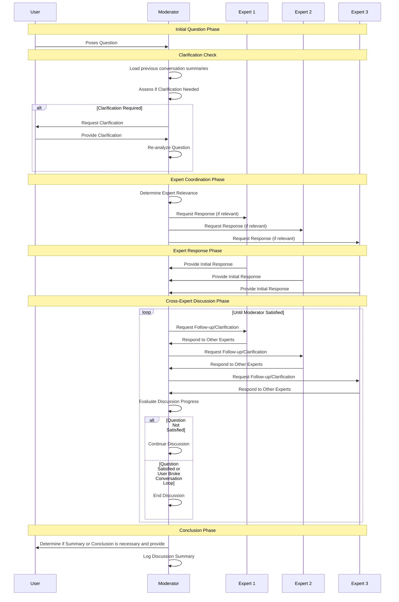
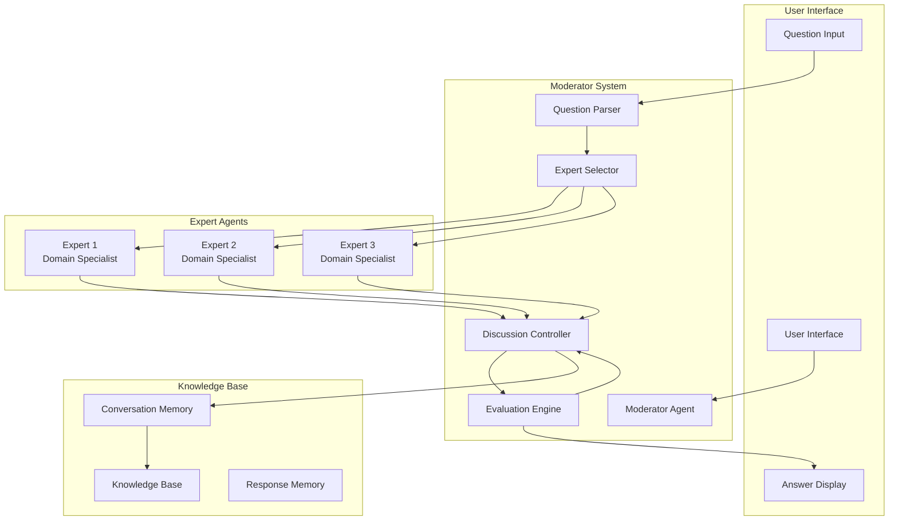

# Panel of Experts - Agentic Loop Visualization
## System Overview
This diagram shows the interaction flow between a user, moderator, and three experts in a conference-style discussion system.

## System Architecture Components

## Key Design Considerations
1. **Moderator Intelligence**: The moderator needs to understand question complexity and expert relevance
2. **Expert Coordination**: Experts should respond to each other naturally, not just the original question
3. **Discussion Flow Control**: The moderator must determine when the question is sufficiently answered
4. **Memory Management**: The system should remember previous discussions and expert interactions
5. **Response Quality**: Each expert should build upon others' responses rather than repeating information
This visualization can help you design the software architecture, API endpoints, and data flow for your panel of experts system.
